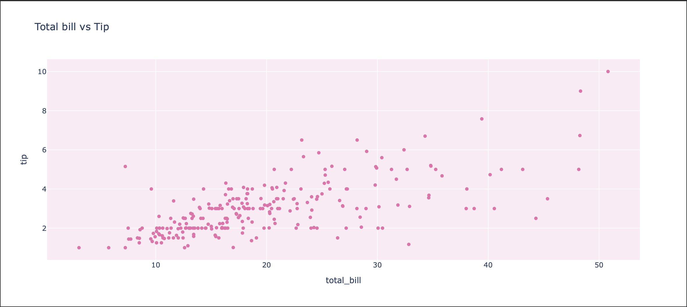
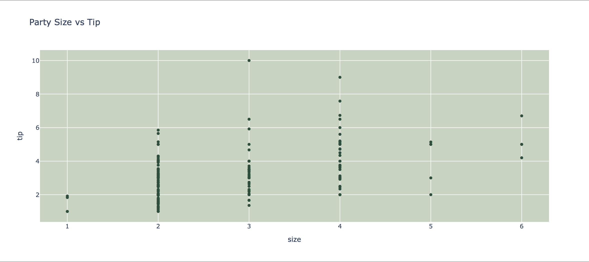
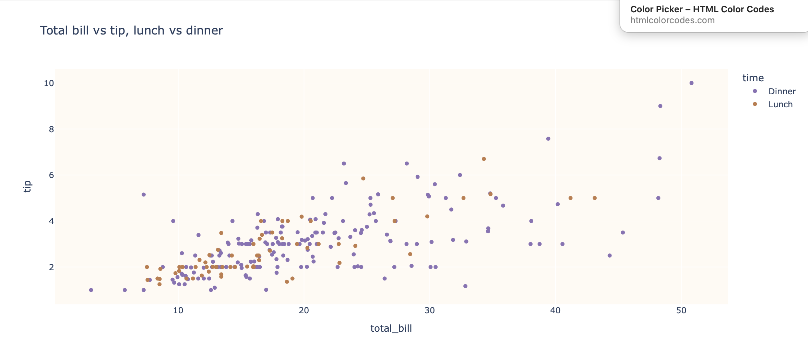
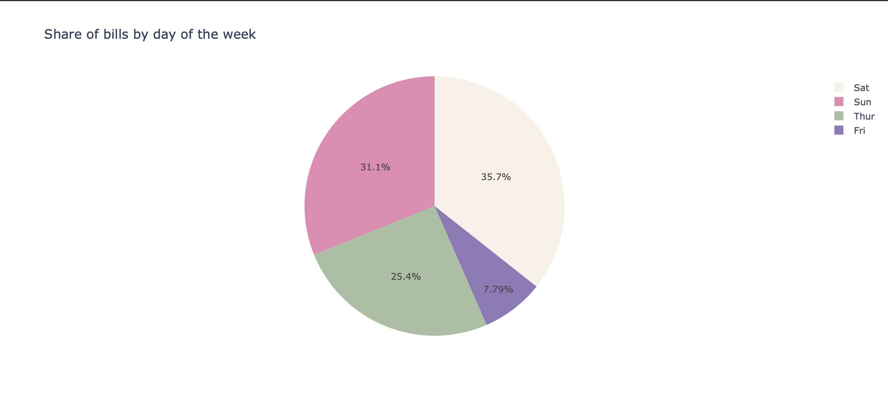
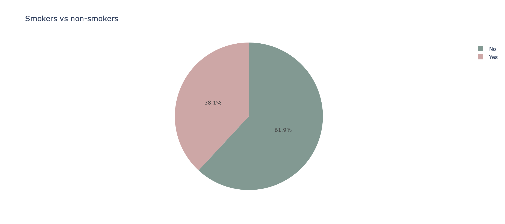
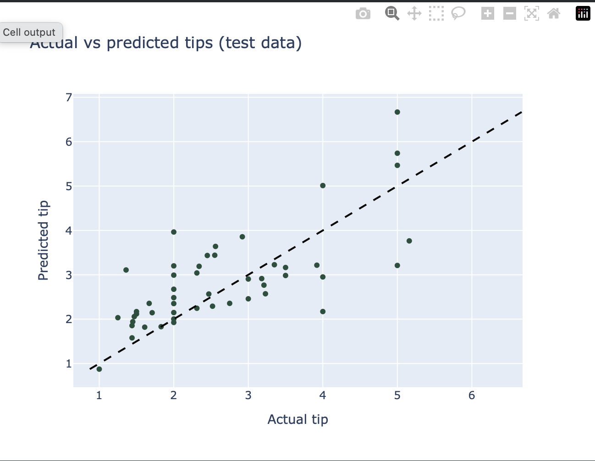

## Introduction
When the bill arrives, how much tip should you leave? This project uses machine learning to **predict the tip (in US dollars)** a waiter receives, based on the total bill, the size of the party, and other details of the meal (day, time, smoker, gender of the payer).

The model is a **Linear Regression** from scikit-learn, built for Station Project 1: The Prediction.

## Getting started
1. Clone the repository: `git clone https://github.com/anahitkeshishyan2007-lab/tumo-waiter-tips-prediction`
2. Install the libraries:
   ```
   pip install pandas numpy plotly scikit-learn notebook
   ```
3. The notebook loads the dataset directly from this link, so no manual download is needed (an internet connection is required):
   `https://raw.githubusercontent.com/amankharwal/Website-data/master/tips.csv`

## How to run and test
1. Start Jupyter:
   ```
   jupyter notebook
   ```
2. Open `TUMO_PS1_Anahit_Keshishyan.ipynb`.
3. Choose **Kernel → Restart & Run All**.
4. The last cells print the accuracy, a sample prediction, and the error numbers, and show the result plot.

## Dataset
The dataset has 244 rows and no missing values.

| Column | Meaning |
|---|---|
| `total_bill` | Total bill in dollars, including tax |
| `tip` | Tip given to the waiter in dollars (**the value we predict**) |
| `sex` | Gender of the person paying the bill |
| `smoker` | Whether the person smoked or not |
| `day` | Day of the week |
| `time` | Lunch or dinner |
| `size` | Number of people |

## Libraries and why they are used
- **pandas**: loads the data, checks for missing values, groups and counts rows, and converts text columns into numbers (`pd.get_dummies`).
- **numpy**: numerical support.
- **plotly.express** (`scatter`, `pie`): visualizes the relationships between features.
- **scikit-learn**:
  - `train_test_split`: splits the data into 80% training and 20% testing, so the model is tested on rows it has never seen.
  - `LinearRegression`: the model that is trained.
  - `model.score()`: measures the accuracy (R²).
  - `model.predict()`: predicts a tip for a given set of features.

## Steps and outputs

### 1. Load and check the data
244 rows, 7 columns, no null values.

### 2. Visualize the relationships
- **Total bill vs tip:** tips rise with the bill (correlation about 0.68), but the dots spread out more on large bills, so the bill alone does not fix the tip.
  
- **Party size vs tip:** the average tip goes up with party size, from about 2.58 dollars for 2 people to about 4.14 dollars for 4. Most parties have 2 people, and very few have 1, 5 or 6, so the model has little data for those sizes.
  
- **Bill vs tip, lunch vs dinner:** both follow a similar upward pattern, but dinner bills are bigger (about 20.80 vs 17.17 dollars on average), so dinner tips are slightly higher.
  
- **Days:** the data is mostly Saturday (87 rows), Sunday (76) and Thursday (62). Only 19 rows are from Friday, so the model has the least to learn from Fridays.
  
- **Smokers:** about 62% of the bills (151 of 244) are from non-smokers, so the data is not perfectly balanced.
  

### 3. Prepare the data
Linear Regression only works with numbers, so the text columns (`sex`, `smoker`, `day`, `time`) were converted into 0/1 columns with `pd.get_dummies(drop_first=True)`. The 8 features are: `total_bill`, `size`, `sex_Male`, `smoker_Yes`, `day_Sat`, `day_Sun`, `day_Thur`, `time_Lunch`. The target is `tip`.

### 4. Split the data
195 rows for training and 49 rows for testing (`test_size=0.2`, `random_state=42` so the results can be repeated).

### 5. Train the model
`LinearRegression().fit(X_train, y_train)`

### 6. Test the model
Results are in the section below. The prediction example and the actual vs predicted plot are also shown there.

## Why Linear Regression?
- The tip is a **number**, not a category, so this is a regression problem.
- The scatter plots show that the tip grows roughly in a straight line with the bill, and a straight line is exactly what Linear Regression fits.
- It is simple and fast, and it is easy to explain: each feature gets a coefficient that shows how much it pushes the tip up or down.

The model was trained with `train_test_split` (80% / 20%). Testing on rows the model has never seen shows how well it works on new bills, not just on the ones it learned from.

## Results

| Model | Training accuracy (R²) | Testing accuracy (R²) |
|---|---|---|
| Linear Regression | 0.458 (45.8%) | 0.437 (43.7%) |

- The training and test scores are close, so the model is **not overfitting**.
- R² measures how much of the variation in tips the model explains. A score of 0.437 means it explains about 44% of that variation. The rest depends on things not in the dataset, such as the quality of the service. R² is not the share of predictions that are exactly right.
- **Average error:** about 0.67 dollars on the test rows.
- **About 80%** of the test predictions are within 1 dollar of the real tip.

**Example prediction:** for a 50 dollar bill, a party of 3, a male non-smoker, on a Saturday at dinner, the model predicts a tip of about **6.01 dollars**.



In the plot above, each dot is one test row. The dots follow the dashed line (a perfect prediction) loosely but spread around it, which matches the R² of about 0.44.

The results are also saved in `results.txt`.

## Author
Anahit Keshishyan
